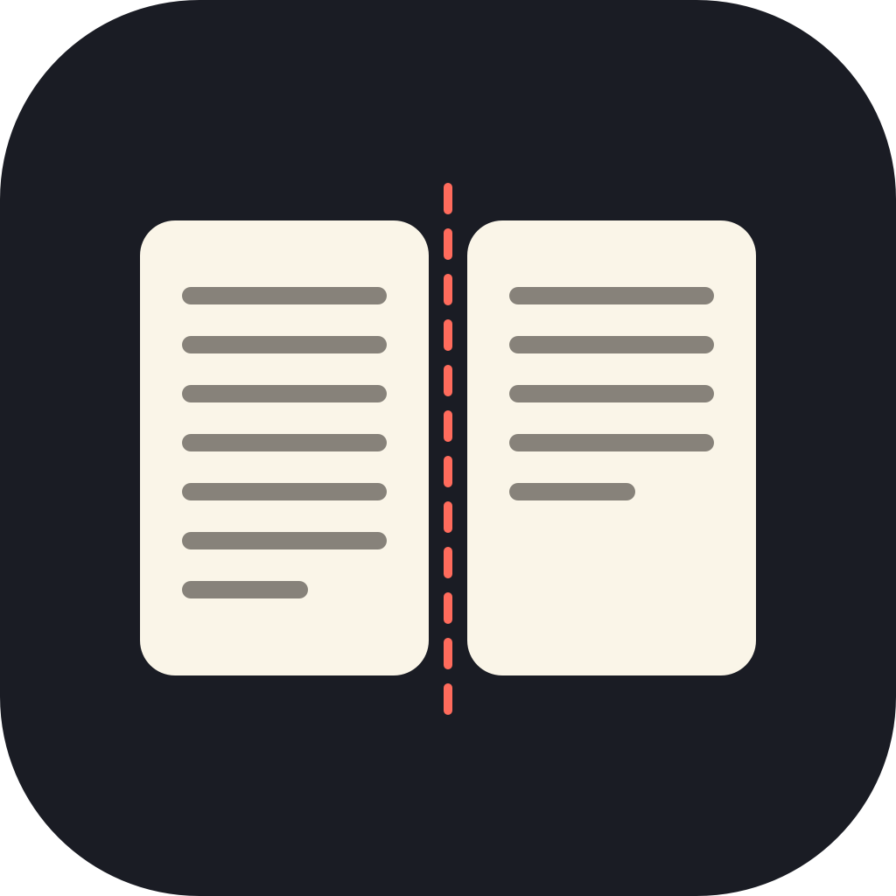
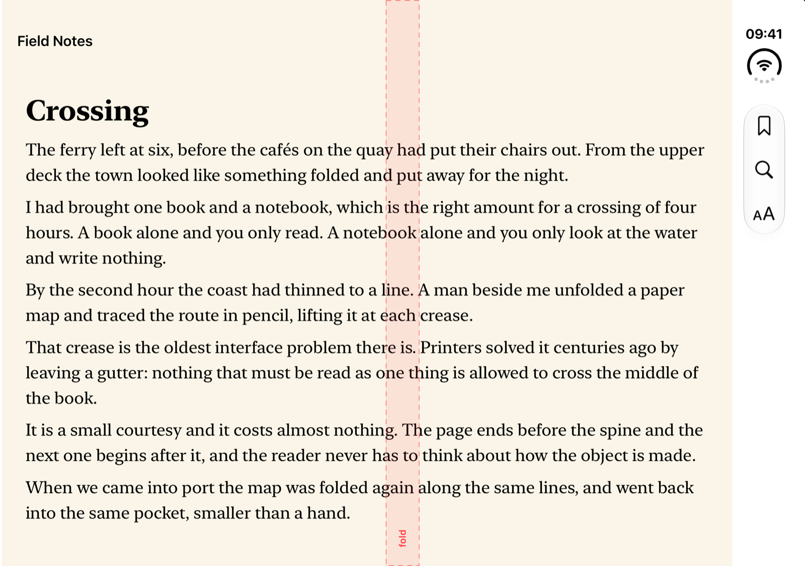
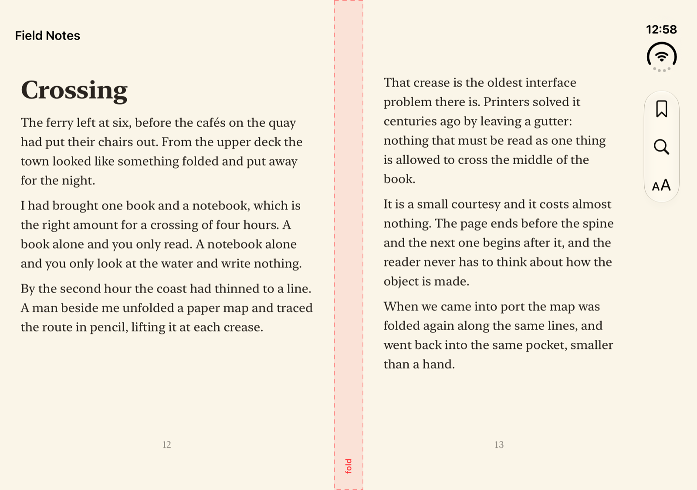
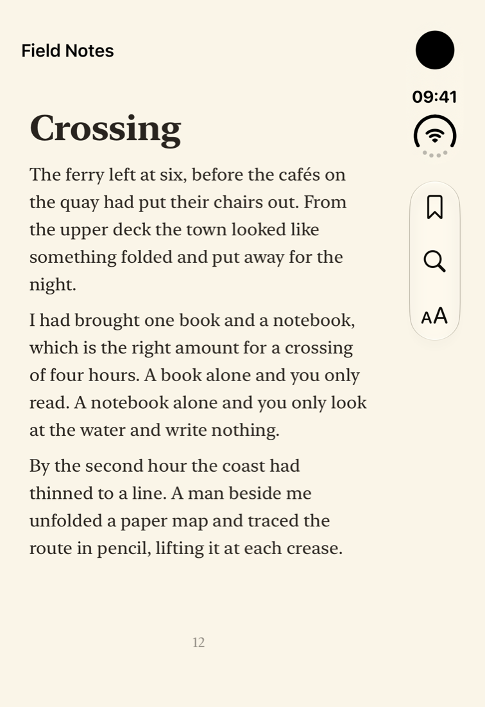
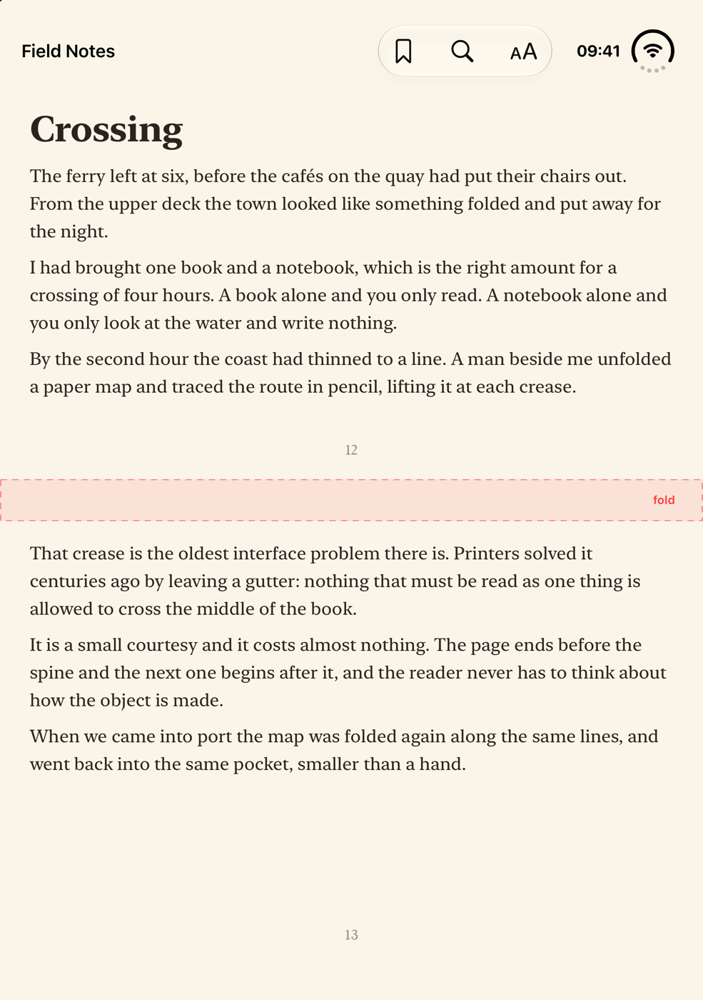

# duo-kit

Agent skills for designing, adapting and testing iOS apps on **iPhone Duo**, Apple's two-display folding iPhone. For Claude Code and Codex.

Language models learned about adaptive layout from the iPad. iPhone Duo shipped after most of them were trained, so they treat it as a small iPad, or as a device that does not exist. It is neither. Asked how a reader screen should look "when the Duo is open in landscape", a clean session without this plugin designed for Microsoft's Surface Duo (see `evals/trigger-prompts.md`). duo-kit gives a model the facts and the working procedures: what the device is, how its two displays, side bars and fold behave, how to lay content out like an open book, how to judge a design in every pose, and how to test it on the simulator.

It is a community project. It is not affiliated with or endorsed by Apple, OpenAI or Anthropic.

## What it looks like

The same reading screen on the iPhone Duo simulator, partially folded. The red band is the fold's reserved region, drawn by the sample app so that a flat screenshot can show where it is.

| What a model builds by default | With `duo-book-layout` |
|---|---|
|  |  |
| One wide column, as on a tablet. Every line crosses the fold. | Two pages either side of the fold. The layout is identical flat and partially folded. |

The same screen in the other poses, with no pose-specific code:

| Closed, outer display | Partially folded like a laptop |
|---|---|
|  |  |
| One page. The toolbar moves to the side by itself. | The pages stack above and below the fold; bars go back to horizontal. |

These images come from `fixtures/DuoBookSample`, the sample app in this repository, running on Apple's simulator. For screenshots of real shipped apps, see the sources that `duo-design-references` describes; their screenshots belong to the apps' makers and are not reproduced here.

## Skills

| Skill | Use it to |
|---|---|
| `duo-app-readiness` | Start here. Learn how the device differs from an iPad, scan an app for assumptions that break, and route each screen to the right skill. |
| `duo-adaptive-layout` | Make one layout grow from the outer display to the inner one, with asymmetric safe areas and state that survives opening and closing. |
| `duo-fold-and-poses` | Keep content off the fold and adapt to book, laptop and tent poses with reserved regions, arrangement views and the hinge. |
| `duo-book-layout` | Put two pages either side of the fold on the open inner display. |
| `duo-vertical-bars` | Get toolbars and tab bars onto the side, in the right order, with sensible overflow. |
| `duo-scenes-and-camera` | Open a second window, or show content on the outer display while the camera runs. |
| `duo-design-references` | Research how shipped apps that are optimized for the device handle a screen. |
| `duo-design-review` | Judge a design or screenshots pose by pose. |
| `duo-pose-testing` | Run, fold and screenshot an app on the simulator in every pose. |

Two optional Claude Code agents wrap the noisiest work: `duo-readiness-scan` and `duo-reference-scout`. All logic lives in the skills, so Codex runs the same procedures inline.

## Conventions this plugin adds

Two rules here go beyond Apple's guidance. Both are stated as such inside the skills.

- **Book layout.** With the device open in landscape, content screens and master–detail pairs use two pages either side of the fold, whether the device is flat or partially folded. Apple only requires keeping content off the fold while it is partially folded. Scrolling lists, maps and immersive media may span the display, with the reason stated.
- **Optimized references only.** When researching shipped apps, only apps verified as optimized for iPhone Duo on the day of the research count. Partly optimized, unoptimized and unverified apps are left out.

## Install

### Claude Code

```bash
claude plugin marketplace add henriquevelloso/duo-kit
```

```bash
claude plugin install duo-kit@duo-kit
```

Inside Claude Code the same two steps are `/plugin marketplace add henriquevelloso/duo-kit` and `/plugin install duo-kit@duo-kit`.

Start a new session afterwards. Skills appear as `duo-kit:duo-app-readiness` and so on.

### Codex

Clone the repository, add the folder to a local marketplace file, and install it. With a personal marketplace at `~/.agents/plugins/marketplace.json`, add an entry whose `source.path` points at the clone, then run `codex plugin add duo-kit@<marketplace name>` and start a new task. Run the same command again after pulling an update, because Codex keeps its own copy.

### Optional

`duo-design-references` can use Duo Gallery's free, read-only MCP server when it is already connected in your environment. The plugin does not install it and works without it. Setup is described at https://duogallery.io/mcp-server.

## Requirements

- Xcode 27.1 or later. The fold, arrangement, hinge and vertical-bar APIs are in the iOS 27.1 SDK.
- An iPhone Duo simulator runtime for `duo-pose-testing`.
- UI tests that set the hinge angle need Xcode 27.3 or later.

## What was verified

See `provenance.json` for the exact Xcode build.

- Every Swift block in the skills type-checks against the iOS simulator SDK.
- The book layout in `fixtures/DuoBookSample` was built and run on an iPhone Duo simulator: closed, open in landscape, partially folded in landscape and partially folded in portrait. The measurements quoted in the skills come from those runs.
- Simulator facts in `duo-pose-testing` (runtime compatibility, display capture) were checked on the same setup.

Not verified: behavior on a physical device, the camera accessory (the simulator has no camera), Split View halves, and the UIKit equivalents, which are described but not compiled. The trigger prompts in `evals/` were run with the plugin in both harnesses, and seven of them without any plugin in Codex; results and their limits are recorded there.

## Maintaining

```bash
python3 scripts/duokit.py sync       # copy shared/not-an-ipad.md into every skill
python3 scripts/duokit.py lint       # structure, banned terms, card freshness, fixture copies
python3 scripts/duokit.py snippets   # type-check every Swift block in skills/
fixtures/DuoBookSample/build.sh      # build the sample app for the simulator
```

Rules for contributions:

- Skills are self-contained and harness-neutral. They name no other plugin and no harness-specific tool; the lint enforces this.
- Apple's text is paraphrased and linked, never copied.
- An API statement says which SDK it was checked against. When Xcode updates, run `snippets` again, re-run the sample and update `provenance.json`.
- Measurements are labelled as measurements and never written into code as constants.
- The "not an iPad" card is edited in `shared/not-an-ipad.md` only.

## Licence

MIT for the project's own text and code. See `LICENSE` and `THIRD_PARTY_NOTICES.md`.
